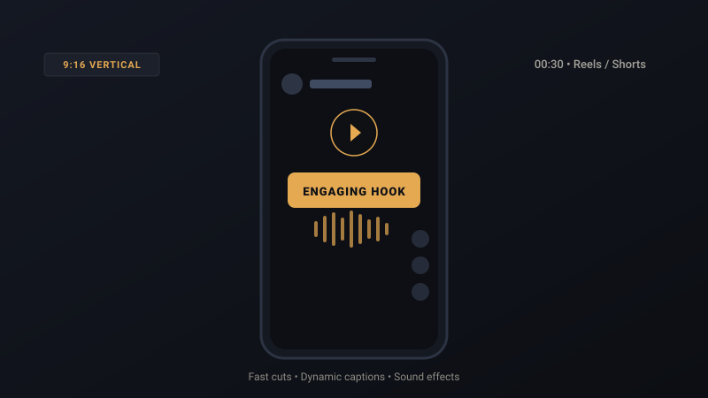

# Puneeth s gowda — Freelance Video Editor Portfolio

A modern, cinematic, responsive portfolio website built specifically for freelance video editor **Puneeth s gowda**.

It is designed with an authentic, confident tone that highlights your genuine passion for video rhythm, storytelling, and pacing without inventing fake clients, awards, or claims.

---

## ✨ Features & Design Highlights

- **Cinematic Dark Theme**: Deep charcoal backgrounds (`#0d0f13`, `#13161c`, `#181c24`), warm white typography (`#f5f4ef`), and a warm amber / cinema gold accent (`#e5a952`).
- **Hero Section**: Displays your name, "Video Editor" title, honest introduction, "Available for freelance projects" live indicator, and a "Watch My Work" call to action.
- **Interactive Showreel & Video Grid**:
  - Filter by category: *All Edits*, *Short-Form & Reels*, *Vlogs & YouTube*, *Events & Highlights*.
  - Built-in accessible modal lightbox: clicking any video card opens a full video player dialog with keyboard navigation (ESC key, focus trap).
  - Supports YouTube embeds, Vimeo embeds, and direct `.mp4` video files.
- **"What I Edit" Section**: Dedicated breakdown for **Social Videos**, **Short-Form Content (Reels/TikTok/Shorts)**, **Vlogs & Storytelling**, and **Event Videos**, plus your editing principles.
- **About Section**: Honest narrative explaining that you are actively building your editing craft, welcoming collaborative freelance projects, complete with your software toolset and 3-step workflow.
- **Contact Section**: One-click email copy button with visual confirmation, response time indicator, social links, and an interactive project inquiry form.
- **Fully Responsive & Accessible**: Custom mobile navigation drawer, fluid typography, ARIA attributes, semantic HTML5, and `prefers-reduced-motion` compliance.
- **Zero Build Step / Zero Dependencies**: Pure HTML5, CSS3, and vanilla JavaScript. Runs anywhere without `npm install` or node dependencies.

---

## 📁 File Structure

```text
project1/
├── index.html                  # Main portfolio webpage with clean placeholder comments
├── README.md                   # Setup, customization, and GitHub deployment guide
├── css/
│   └── style.css               # Cinematic dark stylesheet with CSS variables
├── js/
│   └── main.js                 # Mobile menu, video modal, filters, copy button
└── assets/
    ├── favicon.svg             # Custom video editor favicon
    ├── placeholder-reel.svg    # Featured showreel visual thumbnail
    ├── placeholder-social.svg  # Vertical 9:16 phone & hook thumbnail
    ├── placeholder-vlog.svg    # 16:9 cinematic landscape thumbnail
    ├── placeholder-event.svg   # Event lighting & highlights thumbnail
    ├── placeholder-talking-head.svg # Framing guides & audio clean-up thumbnail
    └── placeholder-travel.svg  # Speed ramps & rhythm montage thumbnail
```

---

## 🛠️ Step-by-Step Customization Guide

All placeholder locations in `index.html` are marked with clear comments starting with `<!-- REPLACE: ... -->`.

### 1. Replacing Your Email & Social Links
Open `index.html` and search for `contact`:
- **Email**: Pre-configured to `puneethsgowda17@gmail.com` (can be updated anytime in `index.html`).
- **Socials**: Update the URLs for:
  - YouTube: `https://youtube.com/@placeholder`
  - Instagram: `https://instagram.com/placeholder`
  - LinkedIn: `https://linkedin.com/in/placeholder`
  - X (Twitter): `https://x.com/placeholder`
  - GitHub: `https://github.com/Puneeth-002`

### 2. Replacing Video Cards with Your Own Work
Each video card in `index.html` has data attributes:

```html
<article class="video-card" 
         data-category="social" 
         data-id="card-social-1"
         data-title="Your Video Title"
         data-category-label="Short-Form"
         data-notes="Brief notes on what you edited (pacing, sound, captions)"
         data-video-url="https://www.youtube.com/embed/YOUR_VIDEO_ID">
  <div class="card-thumbnail-wrap" data-video-trigger>
    <!-- Replace src with your thumbnail image (e.g., assets/my-thumb.jpg) -->
    
    ...
```

- **YouTube**: Use the embed URL format `https://www.youtube.com/embed/VIDEO_ID`
- **Vimeo**: Use `https://player.vimeo.com/video/VIDEO_ID`
- **Direct MP4**: Use `videos/my-edit.mp4`

### 3. Customizing the About Section & Tools
In `index.html` under `<section id="about">`, you can adjust your personal bio, software tools (Premiere Pro, DaVinci Resolve, CapCut, etc.), or workflow steps to match your exact setup.

---

## 🚀 How to Preview Locally

Double click `index.html` to open it in Google Chrome, Microsoft Edge, or any modern web browser.

Alternatively, if you use VS Code, install the **Live Server** extension and click **Go Live**.

---

## 🌐 How to Push to GitHub & Publish on GitHub Pages

Because your repository is at `https://github.com/Puneeth-002/project1.git`, you can host this site for free on GitHub Pages:

### Step 1: Push the Files to GitHub
Open your terminal (or GitHub Desktop) in the `project1` folder:

```bash
# Initialize git if not already done
git init
git branch -M main

# Add the remote repository
git remote add origin https://github.com/Puneeth-002/project1.git

# Stage all files
git add .

# Commit
git commit -m "Initial commit: cinematic video editor portfolio"

# Push to GitHub
git push -u origin main
```

*(If you use GitHub Desktop: simply select "Add Local Repository", point it to this `project1` folder, and click "Publish repository".)*

### Step 2: Enable Free GitHub Pages Hosting
1. Go to your repository on GitHub: `https://github.com/Puneeth-002/project1`
2. Click **Settings** (gear tab at the top right of the repository).
3. In the left sidebar, click **Pages**.
4. Under **Build and deployment** > **Source**, choose **Deploy from a branch**.
5. Under **Branch**, select `main` and `/ (root)`, then click **Save**.
6. Within 1 to 2 minutes, your website will be live at:
   `https://puneeth-002.github.io/project1/`

---

## 🎨 Modifying Colors & Typography

All design tokens are defined in `css/style.css` at the top in `:root`:

- `--accent`: The warm amber/gold accent color (`#e5a952`). You can tweak this to any accent you prefer.
- `--bg-body`: The dark charcoal background (`#0d0f13`).
- `--text-primary`: Warm white text (`#f5f4ef`).
